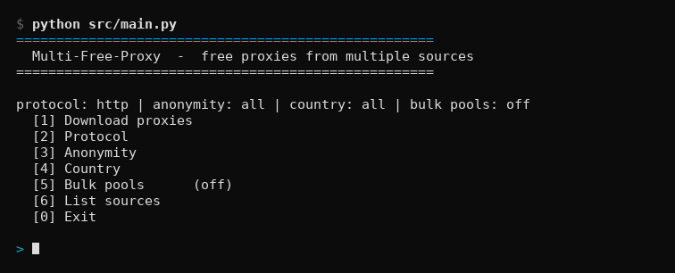
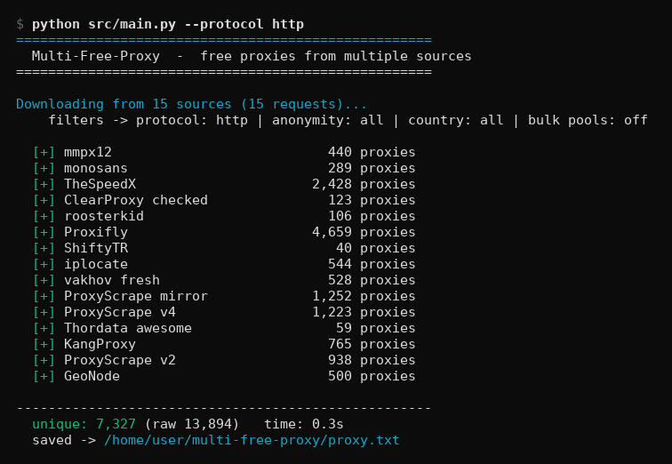

# multi-free-proxy

Collects free proxies from a bunch of public APIs and lists, merges them and
writes everything to `proxy.txt`. Terminal only, no web UI.

## Running

On Windows just double-click `start.bat`. On anything else:

    python -m pip install -r requirements.txt
    python src/main.py

`start.bat` always runs `src/main.py` first. It installs `requirements.txt`
only when python exits with code 2 (missing library) and then starts the app
again. If the app runs fine, nothing gets installed.

## Filters

- protocol: http, https, socks4, socks5
- anonymity: elite, anonymous, transparent
- country: 2-letter code (us, de, kz, ...)
- bulk pools: off by default. Turning this on adds huge unchecked dumps that
  contain a lot of dead proxies.

Sources that can't apply the filters you picked are skipped. Menu option 6
shows which ones are active at the moment.

If you don't want the menu there's a CLI too:

    python src/main.py --protocol socks5 --anonymity elite --country us
    python src/main.py --protocol https --bulk --output my_proxies.txt

## Output

`proxy.txt` in the project folder, one `ip:port` per line, deduplicated and
sorted.

## Sources

Checked on 2026-10-14, all of these were alive:

| source | type | filters |
|---|---|---|
| ProxyScrape v4 | API | protocol, anonymity, country |
| ProxyScrape v2 | API | protocol, anonymity, country |
| GeoNode | JSON API | protocol, anonymity, country |
| ProxyScrape mirror | jsDelivr mirror | protocol, country |
| ClearProxy checked | checked list | protocol, country |
| Thordata awesome | validated list | protocol / anonymity / country |
| TheSpeedX | list | protocol |
| monosans | list | protocol |
| iplocate | list | protocol |
| Proxifly | list | protocol |
| ShiftyTR | list | protocol |
| mmpx12 | list | protocol |
| roosterkid | list | protocol |
| vakhov fresh | list | protocol |
| KangProxy | list | protocol |
| MuRongPIG pool | bulk, unchecked | protocol |
| GFP pool | bulk, unchecked | protocol |
| hookzof socks5 | bulk, unchecked | socks5 |

There are tons of other free proxy sites out there. Most of the rest are
HTML-only (spys.one, hidemy.name, freeproxy.world, ...) or plain dead
(pubproxy.com, proxy-list.download), so they're not in here. Adding a source
is one entry in `src/sources.py`.

## Layout

    multi-free-proxy/
    ├── README.md
    ├── LICENSE
    ├── start.bat
    ├── requirements.txt
    ├── images/          screenshots for this readme
    │   ├── menu.png
    │   └── download.png
    └── src/
        ├── main.py      terminal UI + downloader
        └── sources.py   source registry

## License

MIT, see [LICENSE](LICENSE).

Free proxies die fast and you shouldn't push anything sensitive through them.
Use them where it's legal and expect half of them to not work.
